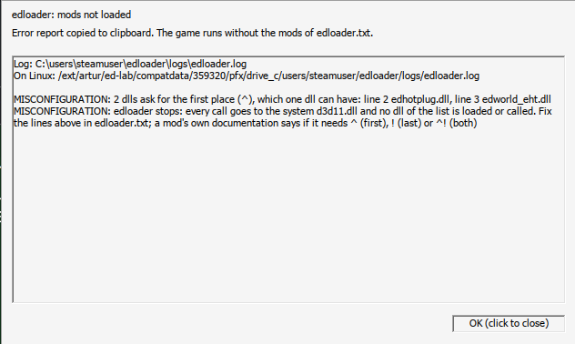

# edloader for players

edloader lets Elite Dangerous use several d3d11 mods at once, for example EDHM, EDVR and edworld. Each of those
mods wants to be the game's `d3d11.dll`, and only one file can have that name. edloader takes the name and loads
the mods one after another, in the order you list them in a text file. Any one of them alone works too: edworld is
not needed for EDHM or EDVR.

## Install

edloader's `d3d11.dll` is in `edloader-<version>.zip` on the [Releases](https://github.com/arturbac/edloader/releases)
page, with an example list, `edloader.txt.example`.

1. Find the game's folder: `Products/elite-dangerous-odyssey-64`, the one with `EliteDangerous64.exe`.
2. Find edloader's folder: `edloader` in your user folder, the same one the game runs under.
   - Windows: `C:\Users\<you>\edloader`.
   - Linux, Steam with Proton: `steamapps/compatdata/359320/pfx/drive_c/users/steamuser/edloader`.

   On a first install this folder is not there yet: make `edloader` with a `plugins` folder in it yourself. On its
   first start edloader adds `config` and `logs` (and `plugins`, if it is missing).
3. Move each mod's `d3d11.dll` out of the game's folder into `edloader\plugins`, under a name of its own, for
   example `d3d11_edvr.dll`, `edworld.dll`, `d3d11_edhm.dll`. Move EDHM's `d3dx.ini`, `d3dcompiler_47.dll`,
   `ShaderFixes` and `EDHM-ini` with it: without them it does not start (`cannot load (error 1114)` in `edloader.log`).
4. Copy edloader's `d3d11.dll` into the game's folder.
5. Write `edloader\edloader.txt`, one mod per line, in the order the game should reach them:

   ```
   # '#' or ';' starts a comment
   edworld.dll           # first: sees the game's own calls
   +d3dcompiler_47.dll   # EDHM's, before it
   d3d11_edhm.dll
   d3d11_edvr.dll        # after EDHM, see "EDHM and EDVR" below
   ```

   A line with `=` is a setting, not a mod; the only one is `accept_takeover` (below).

   A mark before a name puts that mod at an end of the list, wherever its line stands: `^` first (it sees the game's
   own calls), `!` last (right before the system d3d11), `^!` both (one dll at both ends). A mod's own documentation
   says if it needs one; the others keep the order of their lines. Spaces after the mark are fine (`^! some_mod.dll`).
   One mod can have the first place and one the last: two mods asking for the same place, `+` together with `^` or
   `!`, other marks (`!^`, `^^`, `++`, `^ !` with a space between), a mark with no name, or one mod on two lines
   without `+` (even a dll that is not a d3d11 mod) is a mistake in the list. edloader then loads none of the list
   and passes every call to the system d3d11, so the game runs without mods, and the log names each mistake
   (`MISCONFIGURATION: ...`). One mod named by two different paths (another drive, a link) is found only when it is
   loaded the second time: then the mods before that line are loaded, and none is called. A name can no longer start
   with `^` or `!`.

   ```
   ^!some_mod.dll        # first and last: its documentation asks for both
   edworld.dll
   +d3dcompiler_47.dll
   d3d11_edhm.dll
   ```

   edloader before these marks takes `^!some_mod.dll` for a file name, cannot load it and leaves that mod out.

   A name alone is taken from `edloader\plugins`; a full path (`D:\mods\x.dll`) is taken as it is. A line starting
   with `+` loads a dll that is not a d3d11 mod (it is loaded, nothing is passed to it).
6. Each mod still reads its own settings. edworld reads `edworld.ini` from `edloader\config` and writes its log to
   `edloader\logs`. For other mods, see where they look: most read their files beside their dll, so keep those beside
   it in `edloader\plugins`.

## Each mod's "original d3d11"

Most mods pass the game's calls on to "the original d3d11.dll". For them to pass it on to the next mod in your
list, that setting must say `d3d11.dll` (the name, not a path to the system's copy):

- EDHM (3Dmigoto) does so by itself.
- EDVR: `real_dll` in the `[advanced]` section of its settings (`edvr-flat.ini`, beside its dll in `edloader\plugins`) set to the
  full path of edloader's `d3d11.dll` in the game's folder, for example
  `C:\Program Files (x86)\Steam\steamapps\common\Elite Dangerous\Products\elite-dangerous-odyssey-64\d3d11.dll`
  (under Proton the same folder as `Z:\` followed by its Linux path). EDVR takes a name alone from its own folder,
  where there is no `d3d11.dll`, and then goes to the system's copy.
- edworld does so by itself under edloader, from 1.2.0-beta.3; before that it needs `next = d3d11.dll` in `edworld.ini`.

A mod pointed at the system's copy ends the list there: the mods after it are not used, and `edloader.log` says
`did not call on` with the mod's name.

## EDHM and EDVR

Put EDHM before EDVR in the list. With EDVR before EDHM, EDHM (3Dmigoto) hands EDVR its own wrapped device; EDVR's flat
anti-aliasing then never finds the game's frame and stands down for the whole session (its log:
`flat stand-down: entered ... no-known-output-copy`). With EDHM first, EDVR gets the real device, as it does when
EDVR is the game's `d3d11.dll` and EDHM is chained behind it.

With EDVR's anti-aliasing on, set `ui_quality = off` in the `[fix]` section of `edvr-flat.ini` (F8: UI quality). EDVR
otherwise makes the cockpit panels bigger, edworld no longer finds them and the navballs are gone. The clouds are not
affected.

## EDHM-UI

EDHM-UI works in the game's folder: its Install puts EDHM there again, over edloader's `d3d11.dll`. After each
Install:

1. Move EDHM's `d3d11.dll` from the game's folder to `edloader\plugins` and name it `d3d11_edhm.dll`.
2. Move EDHM's compiler, `d3dcompiler_47.dll`, from the game's folder to `edloader\plugins` (without it EDHM does not
   start).
3. Move EDHM's `d3dx.ini` from the game's folder to `edloader\plugins`.
4. Copy edloader's `d3d11.dll` back into the game's folder.
5. `edloader.txt` has EDHM's two lines (once is enough):

   ```
   +d3dcompiler_47.dll
   d3d11_edhm.dll
   ```

After a new theme copy `EDHM-ini` and `ShaderFixes` from the game's folder into `edloader\plugins` again. Under Linux
those two folders are links into EDHM-UI's own folder: the same links in `edloader\plugins` make the copying needless.

## A mod that takes the game's calls itself

Some mods do not wait to be called: the moment they are loaded they rewire the game so that its d3d11 calls go
straight to them, past the list. edloader notices this (the game's import of `D3D11CreateDevice` now leading to
that mod, or the system d3d11 changed) and **stops**: its log says `TAKEOVER:` with the mod's name, and the game
runs with no mod of the list called by edloader. Then either remove that mod from the list, or put it **first** in
the list and add the line

```
accept_takeover = true
```

to `edloader.txt`: edloader logs the takeover and still passes the calls on down the list, at your own risk.

The hook may also come from outside the list: something loaded before edloader started or beside it (another wrapper
in the game's folder, an overlay, a security program). edloader starts at the game's first device, not when the game
starts, so such a hook is often there already; the log says `before edloader started:` or names no mod of the list,
and there is nothing to remove from the list. Add `accept_takeover = true` to `edloader.txt` then. While edloader is
stopped, its device lines say `through 0 element(s) (edloader stopped by a TAKEOVER: the list skipped)`.

## The Epic Games Store: Epic's overlay

The game from the Epic Games Store loads Epic's overlay, `EOSOVH-Win64-Shipping.dll`. A second or two after the
game has made its graphics device, the overlay rewires the game's `D3D11CreateDevice` and the `LoadLibrary` and
`GetProcAddress` imports of most of the dlls in the game. That is Epic's overlay at work, not a broken install.
edloader knows it: it does not stop for it and needs nothing set; the log says so once
(`EOSOVH-Win64-Shipping.dll is Epic's overlay, a known taker: accepted`) and counts the imports in one line
(`... imports of the loader's functions lead to EOSOVH-Win64-Shipping.dll`). The overlay's own device goes down the
list too (its line says `called from EOSOVH-Win64-Shipping.dll`). edworld (from 1.2.0-beta.7) does not follow a
device asked for from outside the game's folder (`not followed` in its log) and stays with the game's.

edloader 1.0.1 and older does not know the overlay: there the log fills with `TAKEOVER:` lines naming it, and
without `accept_takeover = true` in `edloader.txt` edloader stops at the first of them, so a device asked for after
it goes to the system d3d11 and no mod of the list sees it. With such an edloader add that line.

## ReShade

ReShade's installer puts it in the game's folder as `dxgi.dll` (for DirectX 10/11/12). When the game loads it,
before edloader starts, ReShade hooks the system d3d11's `D3D11CreateDevice`, so its own wrapper sits under the mods
of the list. edloader knows ReShade by what it exports (`ReShadeRegisterAddon`): it does not stop for it and needs
nothing set; the log says so once (`ReShade is loaded (dxgi.dll), a known taker: accepted`). Tested with ReShade
6.8.0 in front of edworld and EDHM: ReShade's banner, EDHM's colours and edworld's drawing all there; not tested with
EDVR.

Under Linux (Proton) the test ran with `WINEDLLOVERRIDES="dxgi=n,b" %command%` in the game's launch options, so that
the game loads ReShade's `dxgi.dll` from its folder; whether it is needed without was not tested.

edloader 1.1.0 and older does not know ReShade: it stops (`TAKEOVER: before edloader started: the system d3d11's
D3D11CreateDevice differs from its file`) and no mod of the list is called. With such an edloader add
`accept_takeover = true` to `edloader.txt`.

## An antivirus

Some antivirus programs hook the game too: Bitdefender's `bdhkm64.dll` and `atcuf64.dll` (seen in a player's log)
are in the process before edloader starts and change kernelbase's `LoadLibrary` and `GetProcAddress`. edloader only
logs those (`before edloader started: kernelbase's ... differs from its file ... (said, not stopped for)`). If the
antivirus hooks the system d3d11 as well and no ReShade is loaded, edloader stops (`TAKEOVER: before edloader started:
the system d3d11's D3D11CreateDevice differs from its file`) and no mod of the list is called. Then add

```
accept_takeover = true
```

to `edloader.txt`. edloader does not accept an antivirus's takeover by itself: with it present, a takeover by a
misplaced mod would pass unnoticed too. edworld from 1.2.0-beta.13 needs nothing set for Bitdefender (its
`creator_pass` lists `bdhkm64.dll` by default).

## Check that it works

Open `edloader\logs\edloader.log` after starting the game. It lists the mods it loaded (`chain[0] = ...`) and
`chain: game -> N proxy(ies) -> system d3d11.dll`. A mod it could not load is named with `cannot load`; a dll that
is not a d3d11 mod with `not a d3d11 proxy`. Without `edloader.txt` the log says `no ...edloader.txt` and the game
runs without any mod. A mistake in the list's marks is a `MISCONFIGURATION:` line each, then `edloader stops`: fix
those lines and start the game again.

When edloader stops (a mistake in the list, or a takeover it does not accept), it also opens a window once, at the
top left of the main screen: `edloader: mods not loaded`, with the log's path (and under Proton the same path on
Linux) and the lines of what stopped it. The same report is put on the clipboard (`Error report copied to
clipboard.`), ready to paste into a message; note that the paths in it hold your account's folder names. A click on
`OK (click to close)` closes the window. The window is made not to take the game's focus, so the game stays on
its full screen; keys do not reach it. The game goes on without the list's mods while it is open.



## After a verification of the game's files

Steam's and the launcher's verification removes from the game's folder everything that is not the game's, so
edloader's `d3d11.dll` with it. The mods, their settings and your list stay in `edloader`, outside the game's folder:
copy edloader's `d3d11.dll` into the game's folder again.

## Remove

Delete edloader's `d3d11.dll` from the game's folder. To go back to one mod, copy that mod's dll from
`edloader\plugins` into the game's folder as `d3d11.dll`, and for EDHM its other files too.
